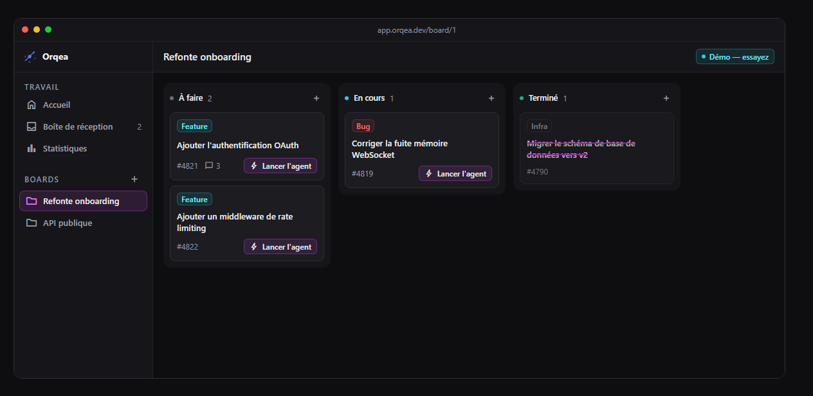
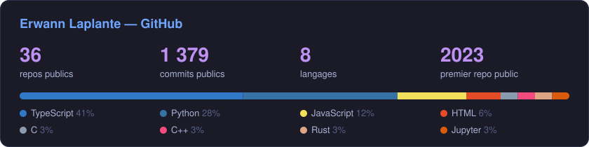
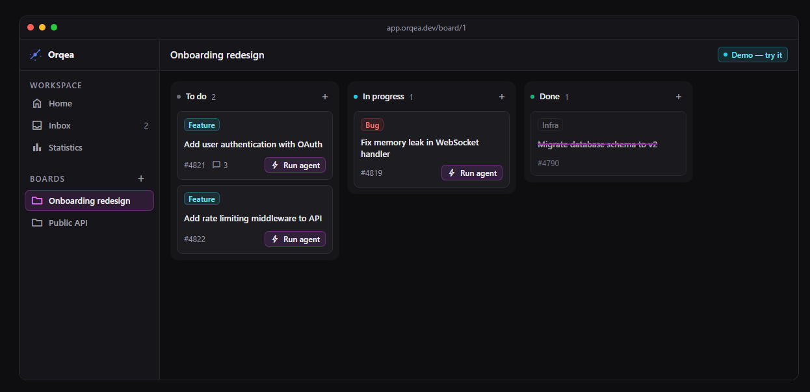

# 👋 Erwann Laplante

### Ingénieur informatique @ Bonifay · Co-fondateur [@Orqea](https://orqea.dev) · Diplômé Epitech 2026

*Je construis des produits réels — pas des side-projects abandonnés.*
 
*I build real products — not abandoned side-projects.*

 

---

## 🧠 En ce moment

- 💼 **Ingénieur informatique chez Bonifay** — depuis septembre 2026
- 🚀 **Co-fondateur d'[Orqea](https://orqea.dev)** — un kanban branché sur toute la chaîne de dev, **en bêta ouverte**
- 📱 **gymtrack** — app Android FR/EN de suivi muscu/cardio, [APK téléchargeable](https://github.com/ErwannL/gymtrack/releases/latest/download/gymtrack-release.apk)

---

## 🎓 Formation

**Epitech Lyon — Programme Grande École (promo 2026)** · 5 ans après le bac

- 📜 **Diplôme d'Expert en Technologies de l'Information** — Bac+5, **visé par le Ministère de l'Enseignement supérieur et de la Recherche**
- 🏅 **Titre RNCP niveau 7 « Expert en ingénierie logicielle »** — reconnu par l'État, même niveau qu'un Master
- 🛠️ Une pédagogie par projets, sans cours magistraux (projets en équipe, stages en entreprise)
- 💊 Projet de fin d'études (EIP) : **PharmaXcess** (voir plus bas)

---

## ⭐ Orqea — la startup que je co-fonde

&nbsp;

> **Un board. Toute votre chaîne de dev derrière.**
> La carte devient du code, la CI le juge, la pull request vous attend.

Un kanban classique branché sur vos outils (Jira, Trello, GitHub, votre modèle d'IA), construit de zéro avec mon co-fondateur. Il est en **bêta ouverte** sur **[orqea.dev](https://orqea.dev)** et on le construit avec ses premiers utilisateurs :

- 🔒 **Chiffrement de bout en bout** des boards (modes `serverOnly` / `twoTierStrict` / `passphraseOnly`)
- 🌐 **Temps réel** Socket.IO — drag & drop, commentaires, notifications instantanées
- 🔌 **Intégrations** GitHub · GitLab · Trello · Jira (import de tâches en quelques clics)
- 🔐 **OAuth** Google · GitHub · Discord
- 🤖 **Agents IA par carte** — « Lancer l'agent » : la carte devient du code, la CI le valide, une pull request est ouverte
- 🌍 **i18n** FR / EN sur tout le produit
- 🐳 **Déploiement Docker** — nginx (front) + Express (back) + MySQL 8, reverse-proxy WSS

**Stack :** `Node.js (ESM)` · `Express 5` · `React` · `Tailwind CSS` · `MySQL 8` · `Socket.IO` · `JWT` · `Docker Compose` · `nginx`

🧪 **Envie de tester ?** [Rejoins la bêta](https://orqea.dev) — chaque retour compte. Contact : [contact@orqea.dev](mailto:contact@orqea.dev)

---

## 💡 GlowPilot — le projet perso dont je suis le plus fier

> **Your lights. Your atmosphere.** Le pilote local-first de tes rubans LED Bluetooth, sans compte et sans cloud.

Je l'ai écrit pour remplacer l'app officielle Lotus Lantern. Je suis parti des travaux publics sur le protocole BLE des contrôleurs ELK-BLEDOM / ELK-BLEDDM, je l'ai vérifié sur du vrai matériel, puis j'ai construit une vraie app autour :

- 🎨 **Moteur de couleurs** — roue, RGB/HSV, température, calibration par appareil (gains, gamma, ordre des canaux)
- ✨ **Effets & scènes** — animations calculées, 29 effets natifs, mode musique au micro, enchaînements de scènes en boucle
- 🖥️ **Automatisation Windows** — *si `Cyberpunk2077.exe` tourne → scène Cyberpunk*, déclenchement par la lecture média, priorités, cooldowns
- ⏰ **Planification** — réveil lumineux progressif, lever et coucher de soleil, minuteur de sommeil
- 📱 **Téléphone ↔ PC** — API LAN appairée : le téléphone pilote le ruban via le PC
- 🧪 **Simulateur et mode test matériel** — tout fonctionne sans ruban, puis chaque commande se vérifie sur le vrai matériel

**Stack :** `TypeScript` · `React` · `Electron` · `Capacitor (Android)` · `Web Bluetooth` · monorepo `apps/` + `packages/`

🔗 [**github.com/ErwannL/GlowPilot**](https://github.com/ErwannL/GlowPilot)

---

## 💊 EIP — PharmaXcess

> **Rendre les médicaments accessibles 24h/24, sans file d'attente.**

Mon **projet de fin d'études Epitech** — deux briques :

- 🏧 **Un distributeur automatique** en vitrine de pharmacie — délivre des médicaments avec ou sans ordonnance via scan carte vitale + pièce d'identité
- 📱 **Une app mobile** — carte des distributeurs, click-and-collect, validation d'ordonnances, suivi de traitement, rappels de prise

**Stack :** `TypeScript` · `Python` · `Java` · `JavaScript`

🔗 [Repo officiel → Jessika63/PharmaXcess](https://github.com/Jessika63/PharmaXcess) · [Ma copie de travail](https://github.com/ErwannL/Epitech_repos/tree/main/tek_4/sem_7/G-EIP-700-LYN-7-1-eip-jessica.ebely)

---

## 🚀 Autres projets

### 🧠 Intelligence Artificielle

| Projet | Description | Tech |
|--------|-------------|------|
| [**NeuroSnake**](https://github.com/ErwannL/NeuroSnake) | Snake piloté par un réseau de neurones (Deep Q-Learning), A* pathfinding, évitement de pièges | Python |
| [**ConnectX**](https://github.com/ErwannL/ConnectX) | Puissance 4 avec IA — minimax, alpha-beta, réseau de neurones | Python |
| [**WordleMind**](https://github.com/ErwannL/WordleMind) | Wordle multimodes — LLM (FLAN-T5), solver par fréquence, FR/EN | Python |
| [**ThinkTacToe**](https://github.com/ErwannL/ThinkTacToe) | Morpion 3×3 / 5×5 — minimax, alpha-beta, iterative deepening | Python |
| [**AIElectivesProject**](https://github.com/ErwannL/AIElectivesProject) | Correction d'orientation d'images + OCR (Tesseract, OpenCV) | Python |
| [**Fitbit**](https://github.com/ErwannL/Fitbit) | Analyse et visualisation de données de santé Fitbit | Python |

### 🎮 Apps & Jeux

| Projet | Description | Tech |
|--------|-------------|------|
| [**ChessArena**](https://github.com/ErwannL/ChessArena) | Échecs PvP / PvE / bot contre bot — bots dont on règle la façon de réfléchir (alpha-bêta, quiescence, critères pondérés), classement Elo détaillé, PWA, Docker, **100 % de couverture de tests** | TypeScript |
| [**gymtrack**](https://github.com/ErwannL/gymtrack) | Suivi muscu/cardio FR/EN — séances live, templates, stats (PR, volume, heatmap), planification, export/import · [APK](https://github.com/ErwannL/gymtrack/releases/latest/download/gymtrack-release.apk) | React · Capacitor |
| [**Dames-la-maison**](https://github.com/ErwannL/Dames-la-maison) | Jeu de dames Android — 23 releases, CI/CD GitHub Actions | Java · HTML |

  

<b>🤖 Bots & Robotique · 🗂️ Archives Epitech</b>

 

| Projet | Description | Tech |
|--------|-------------|------|
| [**EpiTrelloBot**](https://github.com/ErwannL/EpiTrelloBot) | Bot Discord qui synchronise les updates Trello en temps réel | Python |
| [**RobotsElective**](https://github.com/ErwannL/RobotsElective) | Programmation de robots physiques en équipe | C++ |
| [**Epitech_repos**](https://github.com/ErwannL/Epitech_repos) | 📚 Mes projets Epitech, de la 1ʳᵉ à la 4ᵉ année | C · C++ · JS · Python · TS |

---

## 🛠️ Stack & Outils

| | |
|:-:|:-:|
| **Langages** |  |
| **Frontend** |  |
| **Backend & Data** |  |
| **DevOps & Infra** |  |

---

## 📊 GitHub

Langages par nombre de repos publics.

---

<b>🇬🇧 English version</b>

 

**Software engineer at Bonifay** (since Sept. 2026) · **Co-founder of [Orqea](https://orqea.dev)** · **Epitech graduate, class of 2026**

🎓 Epitech's 5-year *Programme Grande École*: a Master's-level degree (Bac+5) approved by the French Ministry of Higher Education, plus a state-registered level-7 (Master's) certification as a software engineering expert.

- 🚀 **[Orqea](https://orqea.dev)** — *One board. Your whole dev chain behind it.* A kanban wired to Jira, Trello, GitHub and your own AI model: the card becomes code, CI judges it, the pull request waits for you. Open beta. Node.js · Express · React · MySQL · Socket.IO · Docker.

- 💊 **PharmaXcess** — my Epitech capstone: a 24/7 medicine vending machine plus a companion mobile app.
- 💡 **GlowPilot** — local-first Bluetooth LED controller (hardware-verified BLE protocol, Windows automation, Android). Electron · React · Capacitor.
- ♟️ **ChessArena** — chess with tunable-thinking bots and a detailed Elo leaderboard, 100% test coverage.
- 📱 **gymtrack** — FR/EN Android workout tracker (React + Capacitor).
- 🧠 **AI side projects** — Deep Q-Learning Snake, Connect-4 minimax/alpha-beta, LLM-powered Wordle.

Let's connect — [LinkedIn](https://www.linkedin.com/in/erwann-laplante/) · [erwann.laplante.pro@gmail.com](mailto:erwann.laplante.pro@gmail.com)

---

## 📬 On discute ?

Dev, fondateur, curieux d'Orqea, ou un projet où il faut **construire vite et propre** — écris-moi.

 

*"Code. Ship. Repeat."*

