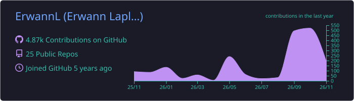
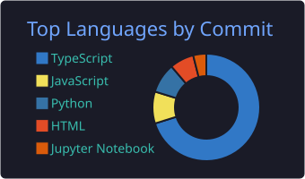
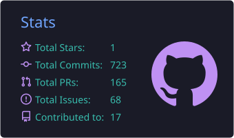

# 👋 Erwann Laplante

### Co-fondateur [@Orqea](https://orqea.dev) · Full-Stack Developer · Epitech Lyon

*Je construis des produits réels — pas des side-projects abandonnés.*
 
*I build real products — not abandoned side-projects.*

 

<!-- TODO: décommenter avec ton URL LinkedIn

-->

---

## 🧠 En ce moment

- 🚀 **Co-fondateur d'[Orqea](https://orqea.dev)** — kanban collaboratif chiffré, alternative à Trello, **en production**
- 💊 **EIP PharmaXcess** — distributeur automatique de médicaments + app mobile (projet de fin d'études Epitech)
- 📱 **gymtrack** — app Android FR/EN de suivi muscu/cardio, [APK téléchargeable](https://github.com/ErwannL/gymtrack/releases/latest/download/gymtrack-release.apk)
- 🎓 **Epitech Lyon** — Master Expert en Technologies de l'Information

---

## ⭐ Orqea — mon projet principal

&nbsp;

> **Une alternative à Trello — temps réel, chiffrée, et pensée pour les équipes qui prennent leur data au sérieux.**

<!-- TODO: ajouter une capture ou un GIF dans assets/orqea.png puis décommenter

-->

Un kanban collaboratif démarré de zéro avec mon co-fondateur, aujourd'hui en production sur **[orqea.dev](https://orqea.dev)** :

| | |
|---|---|
| 🔒 | **Chiffrement de bout en bout** des boards (modes `serverOnly` / `twoTierStrict` / `passphraseOnly`) |
| 🌐 | **Temps réel** Socket.IO — drag & drop, commentaires, notifications instantanées |
| 🔌 | **Intégrations** GitHub · GitLab · Trello · Jira (import de tâches en quelques clics) |
| 🔐 | **OAuth** Google · GitHub · Discord |
| 🤖 | **Agents IA** par carte (prompts custom, automatisations) |
| 🌍 | **i18n** FR / EN sur tout le produit |
| 🐳 | **Déploiement Docker** — nginx (front) + Express (back) + MySQL 8, reverse-proxy WSS |

**Stack :** `Node.js (ESM)` · `Express 5` · `React` · `Tailwind CSS` · `MySQL 8` · `Socket.IO` · `JWT` · `Docker Compose` · `nginx`

📬 Partenariat, question, feedback → [contact@orqea.dev](mailto:contact@orqea.dev)

---

## 💊 EIP — PharmaXcess

> **Rendre les médicaments accessibles 24h/24, sans file d'attente.**

Mon **projet de fin d'études Epitech** — deux briques :

- 🏧 **Un distributeur automatique** en vitrine de pharmacie — délivre des médicaments avec ou sans ordonnance via scan carte vitale + pièce d'identité
- 📱 **Une app mobile** — carte des distributeurs, click-and-collect, validation d'ordonnances, suivi de traitement, rappels de prise

**Stack :** `TypeScript` · `Python` · `Java` · `JavaScript`

🔗 [Repo officiel → Jessika63/PharmaXcess](https://github.com/Jessika63/PharmaXcess) · [Ma copie de travail](https://github.com/ErwannL/Epitech_repos/tree/main/tek_4/sem_7/G-EIP-700-LYN-7-1-eip-jessica.ebely)

---

## 🚀 Autres projets

### 🧠 Intelligence Artificielle

| Projet | Description | Tech |
|--------|-------------|------|
| [**NeuroSnake**](https://github.com/ErwannL/NeuroSnake) | Snake piloté par un réseau de neurones (Deep Q-Learning), A* pathfinding, évitement de pièges | Python |
| [**ConnectX**](https://github.com/ErwannL/ConnectX) | Puissance 4 avec IA — minimax, alpha-beta, réseau de neurones | Python |
| [**WordleMind**](https://github.com/ErwannL/WordleMind) | Wordle multimodes — LLM (FLAN-T5), solver par fréquence, FR/EN | Python |
| [**ThinkTacToe**](https://github.com/ErwannL/ThinkTacToe) | Morpion 3×3 / 5×5 — minimax, alpha-beta, iterative deepening | Python |
| [**AIElectivesProject**](https://github.com/ErwannL/AIElectivesProject) | Correction d'orientation d'images + OCR (Tesseract, OpenCV) | Python |
| [**Fitbit**](https://github.com/ErwannL/Fitbit) | Analyse et visualisation de données de santé Fitbit | Python |

### 🎮 Apps & Jeux

| Projet | Description | Tech |
|--------|-------------|------|
| [**gymtrack**](https://github.com/ErwannL/gymtrack) | Suivi muscu/cardio FR/EN — séances live, templates, stats (PR, volume, heatmap), planification, export/import · [APK](https://github.com/ErwannL/gymtrack/releases/latest/download/gymtrack-release.apk) | React · Capacitor |
| [**Dames-la-maison**](https://github.com/ErwannL/Dames-la-maison) | Jeu de dames Android — 23 releases, CI/CD GitHub Actions | Java · HTML |

<b>🤖 Bots & Robotique · 🗂️ Archives Epitech</b>

 

| Projet | Description | Tech |
|--------|-------------|------|
| [**EpiTrelloBot**](https://github.com/ErwannL/EpiTrelloBot) | Bot Discord qui synchronise les updates Trello en temps réel | Python |
| [**RobotsElective**](https://github.com/ErwannL/RobotsElective) | Programmation de robots physiques en équipe | C++ |
| [**Epitech_repos**](https://github.com/ErwannL/Epitech_repos) | 📚 Mes projets Epitech, de la 1ʳᵉ à la 4ᵉ année | C · C++ · JS · Python · TS |

---

## 🛠️ Stack & Outils

| | |
|:-:|:-:|
| **Langages** |  |
| **Frontend** |  |
| **Backend & Data** |  |
| **DevOps & Infra** |  |

---

## 📊 GitHub

 

  

<picture>
  <source media="(prefers-color-scheme: dark)" srcset="https://raw.githubusercontent.com/ErwannL/ErwannL/snake/snake-dark.svg" />
  
</picture>

---

<b>🇬🇧 English version</b>

 

**Co-founder of [Orqea](https://orqea.dev)** and full-stack developer at Epitech Lyon.

- 🚀 **[Orqea](https://orqea.dev)** — an end-to-end encrypted, real-time Kanban (Trello alternative), live in production. Node.js · Express · React · MySQL · Socket.IO · Docker.
- 💊 **PharmaXcess** — my Epitech capstone: a 24/7 medicine vending machine plus a companion mobile app.
- 📱 **gymtrack** — FR/EN Android workout tracker (React + Capacitor).
- 🧠 **AI side projects** — Deep Q-Learning Snake, Connect-4 minimax/alpha-beta, LLM-powered Wordle.

Open to opportunities and collaborations — [erwann.laplante.pro@gmail.com](mailto:erwann.laplante.pro@gmail.com)

---

## 📬 On discute ?

Recruteur, dev, ou un projet où il faut **construire vite et propre** — écris-moi.

 

*"Code. Ship. Repeat."*

